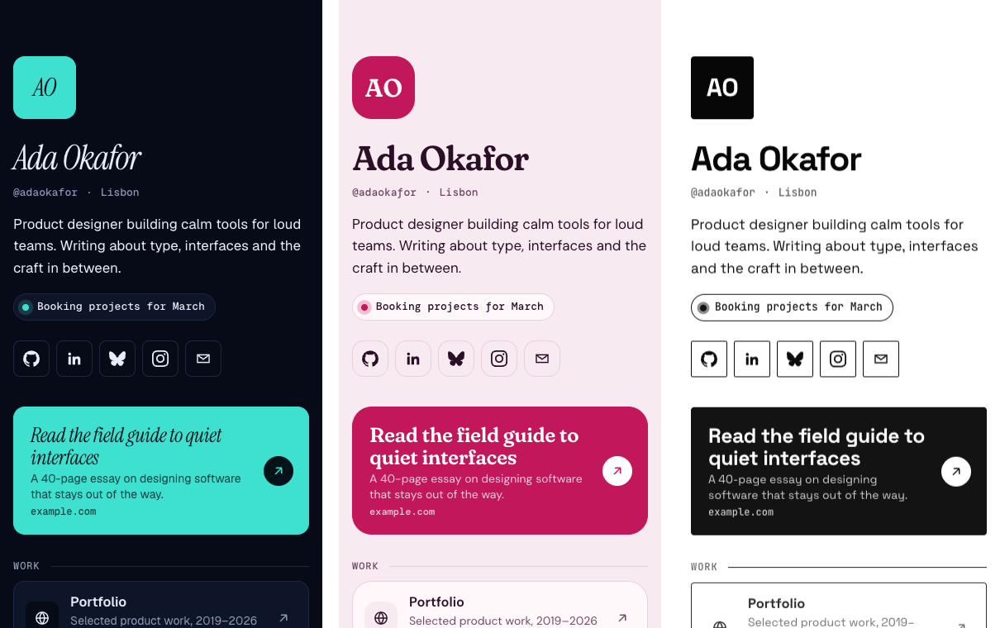

# social-links

A design-first, open-source link-in-bio page. You write one YAML file; it builds to a single static HTML page (~19 KB, no JavaScript) that you can host for free on Cloudflare.

It's set up so that coding agents like Claude Code, Cursor or Codex can maintain it. Tell your agent "add my podcast link", and it edits `links.yml`, validates it against a schema and rebuilds.

<p align="center"></p>

## Why

- **One file to edit.** `links.yml` holds the whole page. A JSON Schema gives you autocomplete in your editor and clear errors such as `links.3.url: must match "^(https?://|mailto:|tel:)"`.
- **Built for agents.** `AGENTS.md` sets the rules, and `npm run validate` points to the exact field to fix.
- **Light.** No framework and no client JS. Icons are inlined and only the ones you use are included. Three runtime dependencies (`yaml`, `ajv`, `simple-icons`).
- **Designed.** Four presets (studio, midnight, bloom, mono), each with tuned light and dark palettes. Every link shows where it goes (`github.com`), there's one optional featured card and an optional live status line. Accessible by default: 44px tap targets, focus rings, AA contrast and reduced-motion support.
- **Free hosting.** Static assets on Cloudflare Workers, with no KV, database or paid features.

## Quick start

```bash
# 1. Use this repo as a template (or fork / clone it)
gh repo create my-links --template rmadrazo97/social-links --public --clone
cd my-links && npm install

# 2. Edit links.yml, then:
npm run validate   # check the config
npm run preview    # build + open a local preview
```

## Deploy to Cloudflare (free)

**Option A: from your terminal**

```bash
npx wrangler login
npm run deploy     # builds and deploys; prints your *.workers.dev URL
```

**Option B: deploy on every push (GitHub Actions)**

1. In the Cloudflare dashboard, create an API token with the **Edit Cloudflare Workers** template.
2. Add the repo secrets `CLOUDFLARE_API_TOKEN` and `CLOUDFLARE_ACCOUNT_ID`.
3. Push to `main`. `.github/workflows/deploy.yml` validates, builds and deploys. Until the secrets exist it only validates and builds.

**Option C: connect the repo in the dashboard**

In Workers & Pages, choose Create → Import a repository. Set the build command to `npm run build` and the deploy command to `npx wrangler deploy`.

**Custom domain:** in the dashboard, open your worker → Settings → Domains & Routes → Add custom domain. Then set `meta.url` in `links.yml`.

## Configure

```yaml
# yaml-language-server: $schema=./schema/links.schema.json
profile:
  name: Ada Okafor
  handle: "@adaokafor"
  bio: Product designer building calm tools for loud teams.
  status: Booking projects for March     # optional live line
  avatar: /avatar.jpg                    # file in public/, or omit for a monogram

socials:
  - { icon: github, url: https://github.com/you }
  - { icon: mail,   url: mailto:you@example.com }

links:
  - title: Read the field guide
    url: https://example.com/guide
    featured: true                       # the big accent card (max one)
  - section: Work                        # groups the links below it
  - { title: Portfolio, url: https://example.com, icon: globe }

theme:
  preset: studio      # studio | midnight | bloom | mono
  mode: auto          # auto | light | dark
  accent: "#2F45FF"   # optional override
  radius: soft        # sharp | soft | round
```

See [`links.yml`](./links.yml) for a full example and [`schema/links.schema.json`](./schema/links.schema.json) for every field. Icons are any [simpleicons.org](https://simpleicons.org) slug, plus `linkedin`, `mail`, `globe`, `link`, `rss`, `phone` and `calendar`.

## Using it with an agent

Open the repo in your agent and ask for changes in plain words:

> Add my new podcast at https://pod.example.com under a "Listen" section with the Spotify icon, then switch to the midnight theme.

The agent follows [`AGENTS.md`](./AGENTS.md). It edits only `links.yml`, runs `npm run validate` until it passes, and deploys only when you ask.

## Project layout

```
links.yml                 ← your content (the only file you normally touch)
public/                   ← avatar, share image, anything copied as-is
schema/links.schema.json  ← the config format
src/render.mjs            ← HTML + CSS renderer
src/themes.mjs            ← preset tokens
src/icons.mjs             ← icon lookup
scripts/build.mjs         ← validate → render → dist/
```

## Scripts

| Command | What it does |
|---|---|
| `npm run validate` | Check `links.yml`. Exits 1 with field-level errors. |
| `npm run build` | Write `dist/` |
| `npm run preview` | Build and serve `dist/` locally |
| `npm run dev` | Build and run under `wrangler dev` |
| `npm run deploy` | Build and deploy to Cloudflare |

## License

MIT. Brand icons come from [simple-icons](https://github.com/simple-icons/simple-icons) (CC0). Brand names and logos belong to their owners.
